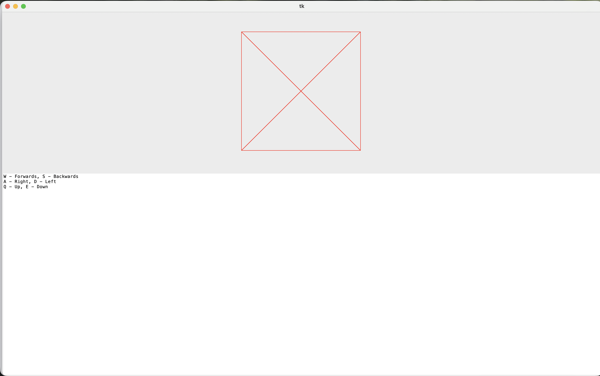
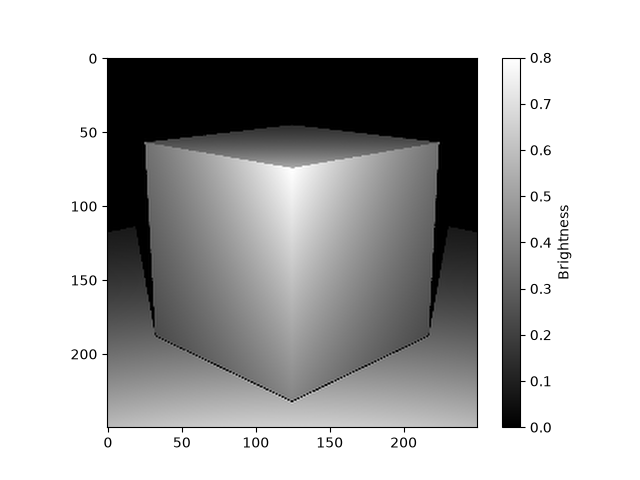

# Open Source Raytracer & Perspective Renderer Suite

A minimalist, bare-bones 3D rendering engine designed for those interested in the fundamental mechanics of computer graphics. This project provides two functions: a **Perspective Renderer** and a **Raytracer**.

## Features
- **Interactive Display:** Integrated with Tkinter for window management and canvas rendering.
- **Geometry Engine:** Custom 3D math calculations powered by NumPy.
- **Wireframe Rendering:** Basic perspective renderer for visualizing 3D shapes.

## Demo
| Perspective Renderer                      | Raytracer                             |
|:------------------------------------------|:--------------------------------------|
|  |  |

## Usage

### Perspective Renderer
To interact with the perspective renderer, you can adjust the **Viewing Point** and the **Target Position** of the camera. You can also modify the vertices of the shape variable.
> **Note:** Please maintain the original variable names to ensure the script runs correctly.

### Raytracer
To use the Raytracer, follow these steps:
1. Create **Face objects** and add them to a list.
2. Assign that list to a **Shape object**.
3. Adjust the camera by modifying the `origin` and `target_pos` variables.
4. Use a **Light object** to define the scene illumination.
5. Call the `render` method of the `Camera` class to generate the image.